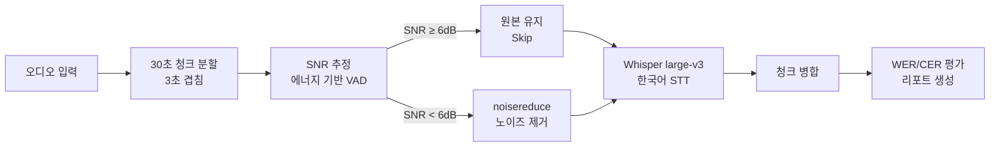

# 한국어 STT 적응형 노이즈 제거 파이프라인

소음이 많은 공공장소 키오스크에서 교통약자가 음성으로 기기를 조작할 수 있도록, **소음 정도(SNR)에 따라 노이즈 제거를 할지 말지를 정하는** 한국어 음성 인식 전처리 파이프라인입니다.

> 한국소프트웨어감정평가학회 제43회 추계학술발표대회 **우수논문상** (2025.11)
> 「교통 약자의 디지털 사이니지 접근성 향상을 위한 음성-영상 기반 UI 파이프라인 설계」
> 김정현\*, 박종섭\* (\*공동 1저자), 최용수(교신저자) · 신한대학교
>
> 논문 전체 파이프라인은 영상 모듈(입술 움직임 기반 발화 감지)과 음성 모듈로 이루어져 있으며, **이 저장소는 음성 모듈**의 코드입니다.

## 핵심 결과

| 항목 | 결과 |
|---|---|
| 전체 WER 변화 | **1.07%p 개선** (20.73% → 19.66%, 파일 6개 평균) |
| 소음이 심한 구간(SNR 6dB 미만) | 평균 **3.21%p 개선** |
| 노이즈 제거를 건너뛴 비율 | **79.4%** (68개 청크 중 54개) |
| 건너뛴 구간의 WER 변화 | 0.00%p (원본 음성 그대로 유지) |

## 문제: 최신 모델을 썼더니 오히려 나빠졌다

처음에는 Transformer 기반 음원 분리 모델 **Sepformer**로 소음을 제거하면 인식률이 오를 거라 기대했습니다. 그런데 Whisper의 한국어 단어 오류율(WER)이 오히려 **17.46%p 늘었습니다.**

원인을 분석한 결과 두 가지를 확인했습니다.

1. Sepformer는 영어 데이터(WSJ0-2mix, LibriMix)로 학습되어, 영어에 없는 한국어 된소리·격음·치찰음을 소음으로 오인하고 지워 버렸습니다.
2. Whisper large-v3는 68만 시간의 다국어 데이터로 학습되어 이미 상당한 잡음 내성을 갖고 있습니다.

그래서 **"꼭 필요할 때만 개입한다(Do No Harm)"** 는 원칙을 세웠습니다. 소음이 심한 구간에만 노이즈를 제거하고, 나머지는 원본을 그대로 Whisper에 넘깁니다.

## 파이프라인 구조



GPU가 2개인 환경에서는 원본 인식(GPU 0)과 노이즈 제거 후 인식(GPU 1)을 병렬로 돌려 같은 청크의 결과를 바로 비교합니다.

## 실험: V1부터 V6까지

처리 방식과 SNR 기준을 바꿔 가며 6개 버전을 비교했습니다. (WER 변화의 `+`는 개선)

| 버전 | 처리 방식 | 건너뛰는 기준 | 노이즈 제거 | Skip률 | WER 변화 |
|---|---|---|---|---|---|
| V1 | 모든 구간 처리 | 없음 | Sepformer | 0% | **−17.46%p** (한국어 음성 왜곡) |
| V2 | 모든 구간 처리 | 없음 | noisereduce (다단계) | 0% | −0.25%p |
| V3 | 모든 구간 처리 | 없음 | noisereduce + SRT 정밀 매칭 | 0% | −0.96%p |
| V4 | 조건부 처리 | SNR ≥ 15dB | noisereduce | 약 50% | −0.48%p |
| V5 | 조건부 처리 | SNR ≥ 8dB | noisereduce | 약 70% | +0.04%p |
| **V6** | **조건부 처리** | **SNR ≥ 6dB** | **noisereduce** | **79.4%** | **+1.07%p** |

이 저장소의 코드는 최종 버전인 **V6**입니다.

### 소음 환경별 결과 (V6)

| 소음 환경 | 평균 SNR | 처리 방식 | Skip률 | WER 변화 |
|---|---|---|---|---|
| Traffic (교통) | 4.7dB | 노이즈 제거 | 17% | +3.78%p |
| Complex (복합) | 6.1dB | 혼합 | 67% | +2.63%p |
| Outdoor (야외) | 8.3dB | Skip | 100% | 0.00%p |
| Construction (공사) | 16.8dB | Skip | 100% | 0.00%p |
| Facility (시설) | 18.3dB | Skip | 100% | 0.00%p |
| Factory (공장) | 18.8dB | Skip | 100% | 0.00%p |

실행 결과 원본은 [`results/v6_summary.json`](results/v6_summary.json)과 [`results/v6_run_log.txt`](results/v6_run_log.txt)에 있습니다.

### 한계

67개 청크에 대한 paired t-test에서는 통계적 유의성이 확인되지 않았습니다(논문 기준 p=0.368). 전체의 79.4%가 처리를 건너뛰어 WER 변화가 0인 구간이 대부분이기 때문입니다. 효과는 노이즈 제거가 실제로 적용된 저SNR 구간(평균 3.21%p 개선)에 집중되어 있으며, 데이터 규모(68개 청크)를 늘린 추가 검증이 필요합니다.

## 프로젝트 구조

```
├─ stt_pipeline/
│  ├─ config.py          # 설정 (SNR 6dB 기준, 청크 길이, GPU 할당 등)
│  ├─ logging_utils.py   # 로그 설정
│  ├─ utils.py           # WER/CER 계산, GPU 메모리 정리
│  ├─ srt_parser.py      # 정답 자막(SRT) 파싱, 청크별 정답 추출
│  ├─ chunk_manager.py   # 30초 청크 분할 (3초 겹침)
│  ├─ noise_analyzer.py  # SNR·스펙트럼 평탄도로 소음 수준 판단
│  ├─ denoiser.py        # V6 조건부 노이즈 제거 (noisereduce)
│  ├─ stt.py             # Whisper large-v3 (faster-whisper)
│  ├─ chunk_merger.py    # 청크 인식 결과 병합 (겹치는 구간 중복 제거)
│  ├─ metrics.py         # 지표 계산
│  ├─ pipeline.py        # 전체 파이프라인 (GPU 2개 병렬 비교)
│  ├─ report.py          # HTML·CSV·통계(JSON) 리포트 생성
│  └─ main.py            # 실행 진입점
├─ scripts/
│  ├─ setup_kaggle.py           # Kaggle 환경 설치 (버전 고정, GPU 확인)
│  └─ clean_kaggle_working.py   # Kaggle 작업 폴더 정리
├─ notebooks/
│  └─ run_on_kaggle.ipynb       # Kaggle에서 실행하는 노트북
├─ results/                     # V6 실행 결과
└─ requirements.txt
```

## 실행 방법

### Kaggle (실험 환경: Tesla T4 x2)

[`notebooks/run_on_kaggle.ipynb`](notebooks/run_on_kaggle.ipynb)를 Kaggle에서 열고, 오디오(wav)와 정답 자막(srt)을 데이터셋으로 추가해 실행합니다.

### 로컬

```bash
pip install -r requirements.txt
# data/ 폴더에 wav 파일과 같은 이름의 srt 파일을 넣습니다.
STT_OUTPUT_DIR=./results_v6 python -m stt_pipeline.main
```

GPU가 없으면 CPU로 동작하지만 Whisper large-v3는 매우 느립니다.

## 데이터

AI-Hub [「극한 소음 음성인식 데이터」](https://aihub.or.kr/aihubdata/data/view.do?dataSetSn=71417)(2022 구축)에서 소음 분류별로 1개씩, 총 6개 파일(교통수단·공사장·공장·시설류·기타·복합소음)을 골라 사용했습니다. 음성과 정답 자막(SRT)을 30초 청크 68개로 나눴고, 유효한 정답이 있는 67개 청크로 WER을 평가했습니다. 데이터는 AI-Hub 이용 약관에 따라 저장소에 포함하지 않았습니다.

## 기술 스택

Python · PyTorch · faster-whisper (Whisper large-v3) · noisereduce · librosa · jiwer · SciPy · Kaggle (T4 x2)
